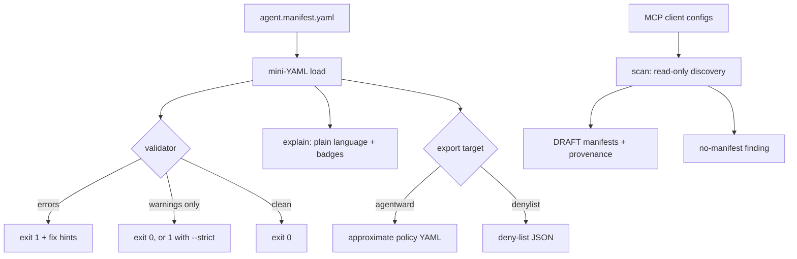

<p align="center">
  
  
  
  
</p>

# manifesto

**Portable AI agent job contracts — a manifest schema, validator/linter, discovery scanner, and exporters so any enforcer can consume the same readable spec.**

```text
$ manifesto validate examples/sales-ops-bot.yaml
== manifesto validate | examples/sales-ops-bot.yaml
  no findings
== 0 error(s), 0 warning(s)
$ echo $?
0
```

## The problem it was built for

Agent setups kept accruing tool-servers and credentials with no portable
declaration of what the agent was actually allowed to do. Every governance tool
spoke its own dialect, so policy could not be reviewed in a diff, logged in git,
or checked for drift. **manifesto** is the unowned glue layer: one readable
`agent.manifest.yaml` contract that a validator checks, a scanner discovers, and
exporters translate into whichever enforcer you run. It is **not** a runtime
proxy — enforcement stays with the enforcer.

## Features

- **One portable contract** — `agent.manifest.yaml` is human-readable, diff-able, and enforcer-agnostic. See [SPEC.md](SPEC.md).
- **Hand-rolled validator** — no `jsonschema`; catches unknown keys, unknown/ungroupable verbs (with "did you mean" suggestions), unbounded grants, empty grants, shadowed grants, and expired/missing ttl — each with a key-path and a fix hint.
- **Bounded where it matters** — money verbs (`payments.charge/refund/payout`) require `amount.max`; `shell.exec` requires `approval: required`. Unbounded grants are rejected.
- **Read-only discovery scanner** — parses hermes/claude/cursor/vscode MCP configs, crontab, and git identity; emits DRAFT manifests with provenance and a "credentials/tool-servers present but no manifest on file" finding. Fixture-testable; never touches your real configs in tests.
- **Deterministic exporters** — AgentWard-style policy YAML and a platform-neutral deny-list JSON; same input always produces the same bytes.
- **Plain-language `explain`** — turns a contract into a sentence with risk badges (`unbounded`, `expired`, `dominated`).
- **Zero dependencies** — pure stdlib. CI/cron-friendly exit codes (`0` clean, `1` findings, `2` usage) with `--strict` for gating warnings.

## Schema overview

```yaml
agent: sales-ops-bot          # required — the contract's subject
version: 1
owner: revenue-team
description: Drafts outreach and charges customers.
ttl: 2027-06-30               # grants expire on this ISO date

grants:                       # anything not granted is DENIED by default
  gmail.read: true            # bounded-free verb -> bare true is fine
  payments.charge:            # money verb -> must carry amount.max
    amount: { max: 500, currency: USD, window: P1D }
    approval: readonly-allowed
  shell.exec:                 # unbounded by nature -> requires approval gate
    approval: required
    rate: { max: 20, window: PT1H }

deny:                         # explicit refusals (clarity / future soft-deny)
  - payments.payout
  - fs.delete

audit:
  receipt_of: [payments.charge]

meta: { team: revenue }       # free-form, ignored by the validator
```

Grant keys follow exactly `<system>.<verb>` (e.g. `gmail.read`, `payments.charge`, `fs.write`, `shell.exec`). Full field reference and rationale live in [SPEC.md](SPEC.md).

## Pipeline



## Format matrix

| Client | Config path (relative to home) | Format | Servers key | Grant inference |
|---|---|---|---|---|
| Hermes Agent | `.hermes/config.yaml` | YAML | `mcp_servers` | per server-name table |
| Claude Desktop | `.claude/claude_desktop_config.json` | JSON | `mcpServers` | per server-name table |
| Cursor | `.cursor/mcp.json` | JSON | `mcpServers` | per server-name table |
| VS Code | `.config/Code/User/mcp.json` | JSON | `servers` | per server-name table |

The scanner also reads `crontab.txt` under the scanned home (or `crontab -l` when scanning a real home) and the git `user.name` / `user.email`.

## Usage

```bash
# Lint a contract (add --json for machines, --strict to fail warnings in CI)
manifesto validate agent.manifest.yaml
manifesto validate --strict --json agent.manifest.yaml

# Read-only discovery of running tool-servers
manifesto scan                       # scan the real home
manifesto scan --client hermes       # one client only
manifesto scan --home fixtures/home  # point at a fixture dir (tests use this)

# Plain-language summary + risk badges
manifesto explain examples/coding-agent.yaml

# Export an enforcer dialect (approximations — review before enforcing)
manifesto export examples/sales-ops-bot.yaml --target agentward
manifesto export examples/sales-ops-bot.yaml --target denylist -o deny.json
```

### Exit codes

| Code | Meaning |
|---|---|
| `0` | clean / valid (warnings allowed unless `--strict`) |
| `1` | findings — validator errors (or warnings under `--strict`); scan "no-manifest" findings |
| `2` | usage error or unreadable manifest |

## Install

```bash
pip install .          # installs the `manifesto` command
# or run straight from source:
python -m manifesto.cli --help
```

On Arch/CachyOS-style systems with an external-managed python (PEP 668), `pip`
refuses to install into the system interpreter — use a venv or pipx:

```bash
python -m venv .venv && .venv/bin/pip install -e . && .venv/bin/manifesto --help
# or
pipx install .
```

Nothing is ever modified: the scanner is read-only, and exporters only write the
file you explicitly name with `-o`.

## Testing

Zero third-party deps — plain `unittest`:

```bash
python -m unittest discover -s tests -t .
```

The matrix covers the validator's failure classes (unknown key, unknown verb,
ungroupable verb, unbounded payment, unbounded shell, empty grant, shadowed
grant, expired/missing ttl), the scanner against `fixtures/home/` (never the real
home), and export determinism (same input → same bytes).

`examples/` holds three runnable contracts — `sales-ops-bot.yaml`,
`coding-agent.yaml`, `personal-assistant.yaml` — validated in the test suite.

## Troubleshooting cookbook

| Finding / hint | What it means | What to do |
|---|---|---|
| `unknown_verb 'x' for system 's'` | The verb isn't in the registry for that system | Take the suggested verb, or extend `KNOWN` in `schema.py` |
| `ungroupable_verb` | Key isn't exactly `<system>.<verb>` | Rewrite as two segments, e.g. `gmail.read` |
| `unbounded_grant` on a money verb | `payments.*` granted without `amount.max` | Add `amount: { max, currency, window }` |
| `unbounded_grant` on `shell.exec` | Shell granted unrestricted | Add `approval: required` (and optionally `rate`) |
| `empty_grant` | Grant is `{}` — grants nothing, hides intent | Write `true` or add real constraints |
| `shadowed_grant` | A deny covers this grant (parent or exact) | Remove the deny, or drop the grant |
| `missing_ttl` (warning) | Grants never lapse on their own | Add `ttl: YYYY-MM-DD`; use `--strict` to force it |
| `no_manifest` (scan) | Tool-servers/credentials with no contract on file | Save the emitted draft as `manifests/<client>.manifest.yaml` |
| `audit_unknown_grant` (warning) | `audit.receipt_of` names a non-granted key | Reference an existing grant key |

## Roadmap

- **v0.2** — attestation & signed receipts (`audit.receipt_of` backed by verifiable receipts); manifest signing.
- **v0.3** — richer interop targets (AgentBound, Permit.io); JSON Schema emission for editors; a `manifesto diff` for drift between a live scan and a committed contract.

## License

MIT — see [LICENSE](LICENSE).
