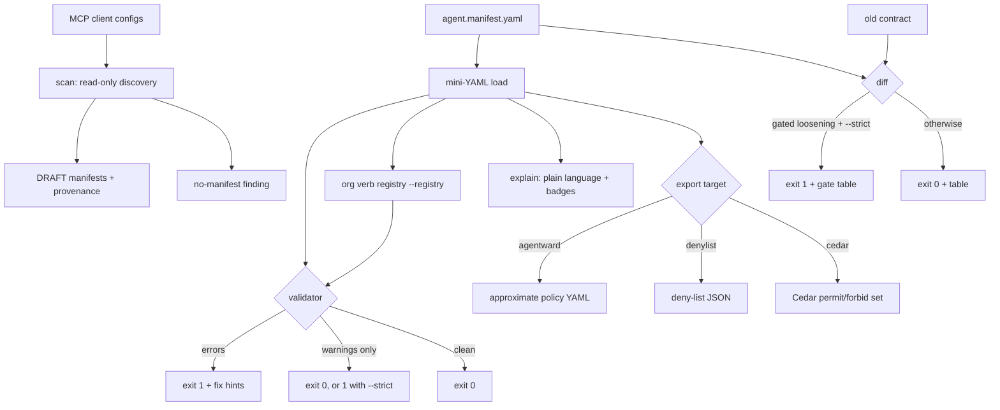

<p align="center">
  
  
  
  
</p>

# manifesto

**Portable AI agent job contracts — a manifest schema, validator/linter, discovery scanner, and exporters so any enforcer can consume the same readable spec.**

```text
$ manifesto validate examples/sales-ops-bot.yaml
== manifesto validate | examples/sales-ops-bot.yaml
  no findings
== 0 error(s), 0 warning(s)
$ echo $?
0
```

## The problem it was built for

Agent setups kept accruing tool-servers and credentials with no portable
declaration of what the agent was actually allowed to do. Every governance tool
spoke its own dialect, so policy could not be reviewed in a diff, logged in git,
or checked for drift. **manifesto** is the unowned glue layer: one readable
`agent.manifest.yaml` contract that a validator checks, a scanner discovers, and
exporters translate into whichever enforcer you run. It is **not** a runtime
proxy — enforcement stays with the enforcer.

## Features

- **One portable contract** — `agent.manifest.yaml` is human-readable, diff-able, and enforcer-agnostic. See [SPEC.md](SPEC.md).
- **Formal machine-readable schema** — a published JSON Schema draft-07 subset at [`schema/agent-manifest.schema.json`](schema/agent-manifest.schema.json). The validator's **structural layer is derived from this file** via a tiny embedded engine (`manifesto/jsonschema_mini.py`) — mutate the schema and the behaviour follows (proven by a canary test). No `jsonschema` dependency.
- **Two-layer validator** — structural checks (types, required, enums, key pattern, unknown keys) come from the schema; semantic checks (unknown/ungroupable verbs with "did you mean", unbounded grants, empty grants, shadowed grants, expired/missing ttl, audit cross-refs, delegation attenuation) come from the registry and business rules — each with a key-path and a fix hint.
- **Bounded where it matters** — money verbs (`payments.charge/refund/payout`) require `amount.max`; `shell.exec` requires `approval: required`. Unbounded grants are rejected.
- **Delegation attenuation** — `delegations:` hand a *narrowed slice* of an agent's power to a sub-agent; the child's `narrower_than` set must be a provable subset of the parent's, `purpose` required, escalation rejected (inspired by Macaroon/Biscuit caveats). `explain` renders the attenuation chain.
- **Fail-closed discovery scanner** — parses hermes/claude/cursor/vscode MCP configs, crontab, and git identity; emits DRAFT manifests with `<file>:<line>` provenance. Inference happens **only on an exact server-table match** — an unknown tool-server or an unparseable config yields `unknown: true`, never a guess. Findings: `type-suspect`, `credential-orphan`, `expired-ttl`, `unbounded-grant`, `no_manifest`. Fixture-testable; never touches your real configs in tests.
- **`manifesto check`** — the **pre-action gate**: a pure, deterministic decision function that answers ALLOW / DENY / REQUIRES_APPROVAL for one *proposed* action against the *current* contract, with the **exact matching clause** that decided it. Evaluates grants, deny dominance, ttl expiry, amount/rate caps, `to_domains`, approval gates, org registry risk classes, and a **delegation's tightened slice** (`--as`). Gives the contract real-time teeth **without** a runtime proxy — embed the function or shell out (exit `0`/`1`/`3`).
- **`manifesto test`** — the **fleet doctor**: cross-checks a manifest against reality (the same home `scan` reads) to catch the two bug classes a validator can't see — **UNDECLARED** tools (present on disk, absent from the contract, with `file:line` provenance) and **PHANTOM** grants (claimed in the contract, no tool found). `--strict` fails on an UNDECLARED tool in a sensitive class.
- **Multi-agent directories** — `validate --dir DIR` / `explain --dir DIR` process every manifest in a folder and add the one cross-file bug a single-file lint can't see: an **agent-name collision** (two contracts claiming the same subject). A collision is an error, not a warning.
- **Deterministic exporters** — three dialects: AgentWard-style policy YAML, a platform-neutral deny-list JSON, and a **Cedar policy set** (`permit`/`forbid` + mapping comments); same input always produces the same bytes. A golden-file suite (`fixtures/golden/`) byte-compares every dialect (labeled APPROXIMATION in [`fixtures/MANIFEST.md`](fixtures/MANIFEST.md)).
- **`manifesto diff`** — compare two contracts and see which grants were **added / removed / tightened / loosened**, what happened to the expiry, and which delegations changed — as a human table or `--json`. `--strict` exits **1** on a loosening in a sensitive class (`payments`, `fs`, `shell`) or a previously-denied area; `--allow-loosening` accepts it explicitly. Built for "this PR removes the payments cap — flagged".
- **Org verb-registry override** — `validate --registry our_verbs.yaml` layers your own `<system>.<verb>` vocabulary over the built-ins (`extend` or `replace`), sets the rule for unknown verbs (`error`/`warning`/`ignore`), and maps verbs to **risk classes** whose gated members must carry `approval: required` (`missing_approval`).
- **Plain-language `explain`** — turns a contract into a sentence with risk badges (`unbounded`, `expired`, `dominated`) and delegation chains.
- **Zero dependencies** — pure stdlib. CI/cron-friendly exit codes (`0` clean, `1` findings, `2` usage) with `--strict` for gating warnings.

## Schema overview

```yaml
agent: sales-ops-bot          # required — the contract's subject
version: 1
owner: revenue-team
description: Drafts outreach and charges customers.
ttl: 2027-06-30               # grants expire on this ISO date

grants:                       # anything not granted is DENIED by default
  gmail.read: true            # bounded-free verb -> bare true is fine
  payments.charge:            # money verb -> must carry amount.max
    amount: { max: 500, currency: USD, window: P1D }
    approval: readonly-allowed
  shell.exec:                 # unbounded by nature -> requires approval gate
    approval: required
    rate: { max: 20, window: PT1H }

deny:                         # explicit refusals (clarity / future soft-deny)
  - payments.payout
  - fs.delete

delegations:                  # ATTENUATION only: hand a narrowed slice to a sub-agent
  - from: sales-ops-bot       # must equal `agent` so the parent's grants are checkable
    to: sales-ops
    narrower_than:            # a provable SUBSET of the parent's grants
      gmail.send: { rate: { max: 20, window: P1D } }
    purpose: coverage handoff # REQUIRED — missing -> error
    ttl: 2027-06-30

audit:
  receipt_of: [payments.charge]

meta: { team: revenue }       # free-form, ignored by the validator
```

Grant keys follow exactly `<system>.<verb>` (e.g. `gmail.read`, `payments.charge`, `fs.write`, `shell.exec`). Full field reference and rationale live in [SPEC.md](SPEC.md).

## Pipeline



## Format matrix

| Client | Config path (relative to home) | Format | Servers key | Grant inference |
|---|---|---|---|---|
| Hermes Agent | `.hermes/config.yaml` | YAML | `mcp_servers` | per server-name table |
| Claude Desktop | `.claude/claude_desktop_config.json` | JSON | `mcpServers` | per server-name table |
| Cursor | `.cursor/mcp.json` | JSON | `mcpServers` | per server-name table |
| VS Code | `.config/Code/User/mcp.json` | JSON | `servers` | per server-name table |

The scanner also reads `crontab.txt` under the scanned home (or `crontab -l` when scanning a real home) and the git `user.name` / `user.email`.

Grant inference is **fail-closed**: a tool-server is mapped to `<system>.<verb>` grants *only* on an **exact** match against the explicit server table. An unrecognized tool-server — or a config that cannot be parsed — is recorded as `unknown: true`, never a guessed capability, and is surfaced for review.

## Usage

```bash
# Lint a contract (add --json for machines, --strict to fail warnings in CI)
manifesto validate agent.manifest.yaml
manifesto validate --strict --json agent.manifest.yaml

# ...layered over your org's own verb registry (see "Org verb registry" below)
manifesto validate agent.manifest.yaml --registry our_verbs.yaml

# Validate (or explain) a WHOLE DIRECTORY of contracts + agent-name collision check
manifesto validate --dir manifests/
manifesto explain --dir manifests/

# Read-only discovery of running tool-servers
manifesto scan                       # scan the real home
manifesto scan --client hermes       # one client only
manifesto scan --home fixtures/home  # point at a fixture dir (tests use this)

# Pre-action gate: is this proposed action allowed by the current contract?
manifesto check agent.manifest.yaml --action gmail.read
manifesto check agent.manifest.yaml --action payments.charge --amount 400
manifesto check agent.manifest.yaml --action http.post --target example.com
manifesto check agent.manifest.yaml --action payments.charge --amount 100 --as sales-ops

# Fleet doctor: cross-check the contract against what's actually on disk
manifesto test agent.manifest.yaml --home ~        # phantom / undeclared audit
manifesto test agent.manifest.yaml --home ~ --strict

# Plain-language summary + risk badges + delegation chains
manifesto explain examples/coding-agent.yaml
manifesto explain examples/delegating-lead.yaml   # shows the attenuation chain

# Export an enforcer dialect (approximations — review before enforcing)
manifesto export examples/sales-ops-bot.yaml --target agentward
manifesto export examples/sales-ops-bot.yaml --target denylist -o deny.json
manifesto export examples/sales-ops-bot.yaml --target cedar -o policy.cedar

# Review a contract change (CI/PR gate on loosening)
manifesto diff main/agent.manifest.yaml pr/agent.manifest.yaml --strict
manifesto diff before.yaml after.yaml --json
```

### Exit codes

| Code | Meaning |
|---|---|
| `0` | clean / valid (warnings allowed unless `--strict`); a `diff` with no gated loosening; a `check` verdict **ALLOW** |
| `1` | findings — validator errors (or warnings under `--strict`); scan "no-manifest" findings; a **gated loosening** under `diff --strict`; an agent-name **collision** under `validate --dir`; a `check` verdict **DENY** |
| `2` | usage error, unreadable manifest, or unreadable/unparseable `--registry` file |
| `3` | `check` verdict **REQUIRES_APPROVAL** — proceed only with a human sign-off |

## Cedar export

`--target cedar` emits a **Cedar policy set** — top-level `permit`/`forbid`
statements with the manifest→Cedar mapping written into the file as comments.
Action ids survive verbatim (`Action::"payments.charge"`); bounds become
`when { context.* }` predicates the enforcer must supply. Recorded output
(`...` marks elisions — every shown line is literal):

```text
$ manifesto export examples/sales-ops-bot.yaml --target cedar
// manifesto export -> cedar (APPROXIMATION)
// generated by manifesto 0.3.0 | dialects are approximations, not certified vendor schemas — review before enforcing
//
// contract: sales-ops-bot | version: 1 | owner: revenue-team
...                                              <- description, ttl, mapping table, caveat
permit(
  principal == Agent::"sales-ops-bot",
  action == Action::"payments.charge",
  resource
)
when {
  context.amount_max == 500
  && context.amount_currency == "USD"
  && context.amount_window == "P1D"
  && context.approval == "readonly-allowed"
};
forbid(
  principal == Agent::"sales-ops-bot",
  action == Action::"fs.delete",
  resource
);
...                                              <- remaining forbids + audit comment
```

Every example has a committed golden (`fixtures/golden/<name>.cedar.expected`),
so the Cedar bytes are byte-stable exactly like the other two dialects.

> **Honest caveat.** The Cedar overrides are **approximations validated
> byte-stable and reviewed manually — not vendor-certified**, not checked
> against any Cedar engine's schema, and not a claim that the `context.*`
> predicates are enforced anywhere. The full mapping table with per-row
> fidelity marks (verbatim / exact / approximation) is in
> [SPEC.md §5.1](SPEC.md).

## Reviewing a contract change — `manifesto diff`

*"This PR raises the payments cap from $500 to $1000."* Run `diff` against the
baseline in CI and the gate answers for you. Recorded output — the loosening
case, exit **1**:

```text
$ manifesto diff fixtures/diff/before.yaml fixtures/diff/after-loosened.yaml --strict
== manifesto diff | fixtures/diff/before.yaml -> fixtures/diff/after-loosened.yaml
AREA             CHANGE          DETAIL
gmail.send       grant changed   rate.max 20 -> 500
payments.charge  grant changed   amount.max 500 -> 1000
shell.exec       grant added     new grant (approval=required)
deny:shell.exec  deny removed    explicit refusal removed
ttl              expiry changed  2027-06-30 -> 2028-06-30 (later)
== 1 grant(s) added, 0 removed, 0 tightened, 3 loosened; 0 deny added, 1 deny removed; 1 expiry changed, 0 delegation(s) changed, 0 audit changed; 5 change(s) total
!! gate: 3 loosening(s) in a sensitive class (payments/fs/shell) or a previously-denied area:
   - [payments] payments.charge: amount.max 500 -> 1000
   - [shell] shell.exec: new grant (approval=required)
   - [shell] deny:shell.exec: explicit refusal removed
!! GATE (--strict): gated loosening -> exit 1 (re-run with --allow-loosening to accept it)
$ echo $?
1
```

The same pair of files when the new contract is *tighter* — exit **0**:

```text
$ manifesto diff fixtures/diff/before.yaml fixtures/diff/after-tightened.yaml --strict
== manifesto diff | fixtures/diff/before.yaml -> fixtures/diff/after-tightened.yaml
AREA             CHANGE          DETAIL
gmail.read       grant removed   grant dropped (was unbounded)
gmail.send       grant changed   rate.max 20 -> 10
payments.charge  grant changed   amount.max 500 -> 250; approval readonly-allowed -> required
deny:fs.delete   deny added      explicit refusal added
ttl              expiry changed  2027-06-30 -> 2026-12-31 (earlier)
== 0 grant(s) added, 1 removed, 3 tightened, 0 loosened; 1 deny added, 0 deny removed; 1 expiry changed, 0 delegation(s) changed, 0 audit changed; 5 change(s) total
$ echo $?
0
```

Note the `gmail.send` rate increase: it is *reported* as a loosening but is
not in a sensitive class, so it does not trip the gate by itself — the gate
owns `payments`, `fs` (and `files`) and `shell`, plus anything the baseline
explicitly denied. Full rules: [SPEC.md §6](SPEC.md).

## Pre-action gate — `manifesto check`

`diff` reviews a change *before it ships*. `check` decides a *proposed action*
*right now*, against the current contract — the pure decision function an
integrator embeds to give the manifest real-time teeth **without** running a
runtime proxy. It answers **ALLOW / DENY / REQUIRES_APPROVAL**, names the
reason, and cites the **exact matching clause** that decided it.

It evaluates, in precedence order: ttl expiry, deny dominance, grant presence
(default-deny), `amount`/`rate` caps, `to_domains`, approval gates, and org
registry risk classes. Recorded output — an allowed read, a cap violation, and
a gated shell action:

```text
$ manifesto check examples/sales-ops-bot.yaml --action gmail.read
== manifesto check | examples/sales-ops-bot.yaml
   agent:  sales-ops-bot
   action: gmail.read
   => ALLOW
   reason: 'gmail.read' is granted within its stated bounds
   clause: grants.gmail.read = true
$ echo $?
0

$ manifesto check examples/sales-ops-bot.yaml --action payments.charge --amount 900
== manifesto check | examples/sales-ops-bot.yaml
   agent:  sales-ops-bot
   action: payments.charge
   => DENY
   reason: amount 900.0 exceeds the cap of 500
   clause: grants.payments.charge.amount.max = 500
$ echo $?
1

$ manifesto check examples/delegating-lead.yaml --action shell.exec
== manifesto check | examples/delegating-lead.yaml
   agent:  sales-lead
   action: shell.exec
   => REQUIRES_APPROVAL
   reason: 'shell.exec' is gated by approval: required
   clause: grants.shell.exec.approval = required
$ echo $?
3
```

**Delegation tightened slice.** `--as <sub-agent>` judges the action on what
the child was *actually handed* (`narrower_than`), never on the parent's full
power. The parent `sales-lead` may charge up to $500; the delegated `sales-ops`
only $50 — so a $100 charge as `sales-ops` is denied against the child's cap:

```text
$ manifesto check examples/delegating-lead.yaml --action payments.charge --amount 100 --as sales-ops
== manifesto check | examples/delegating-lead.yaml
   agent:  sales-ops
   action: payments.charge
   => DENY
   reason: amount 100.0 exceeds the cap of 50
   clause: delegations[0].narrower_than.payments.charge.amount.max = 50
$ echo $?
1
```

`--json` emits the same decision for a machine, and `--registry` layers an org
risk-class gate (a gated class forces `REQUIRES_APPROVAL`). Exit codes are
deliberately distinct: `0` allow, `1` deny, `2` usage, `3` requires-approval —
so a wrapper can branch on the verdict.

## Drift & phantom audits — `manifesto test`

A self-declared contract only contains what its author *remembered*.
`manifesto test` cross-checks it against **reality** (the same home `scan`
reads) and surfaces the two bug classes a validator structurally *cannot* see,
because they are drift, not shape:

- **UNDECLARED** — a tool-server is present on disk but its capability is
  absent from the manifest (the agent can do something the contract forgot),
  reported with `<file>:<line>` provenance.
- **PHANTOM** — the manifest claims a grant but no corresponding tool was
  found (a dead contract entry — authority naming nothing real).

Inference is the scanner's **fail-closed** exact-match table, so an unknown
server never becomes a guessed grant. Recorded output against the drift
fixture:

```text
$ manifesto test fixtures/drift/agent.manifest.yaml --home fixtures/home
== manifesto test | agent=drift-bot | home=fixtures/home
   declared grants: 4 | tools on disk: 7
   KIND      KEY            DETAIL
   PHANTOM   calendar.read  manifest grants 'calendar.read' but no 'calendar' tool-server was found under the scanned home (dead contract entry)
   PHANTOM   gmail.send     manifest grants 'gmail.send' but no 'gmail' tool-server was found under the scanned home (dead contract entry)
   UNDECLARED broken-shell   hermes/broken-shell -> shell present on disk but 'shell.*' is absent from the declared manifest  [fixtures/home/.hermes/config.yaml:19]
   UNDECLARED context7       claude/context7 -> http present on disk but 'http.*' is absent from the declared manifest  [fixtures/home/.claude/claude_desktop_config.json:3]
   UNDECLARED slack          vscode/slack -> slack present on disk but 'slack.*' is absent from the declared manifest  [fixtures/home/.config/Code/User/mcp.json:3]
   UNDECLARED stripe         cursor/stripe -> payments present on disk but 'payments.*' is absent from the declared manifest  [fixtures/home/.cursor/mcp.json:3]
== 4 undeclared tool(s), 2 phantom grant(s); 6 finding(s) total
!! --strict: 2 UNDECLARED tool(s) in a sensitive class (payments/fs/shell) -> exit 1
$ echo $?
0
```

By default findings are reported but do not fail the build. `--strict` exits
**1** — and an UNDECLARED tool in a **sensitive class** (`payments`, `fs`,
`shell`) is the dangerous direction (real capability the contract forgot), so
it is the one that always trips `--strict`. `--json` emits the machine report.

## Multi-agent directories — `validate --dir`

A fleet is a *directory* of contracts. `--dir` validates (or `explain`s) every
`*.yaml`/`*.yml`/`*.json` in a folder and adds the one bug that is invisible to
any single-file lint: a **cross-file agent-name collision** — two contracts
claiming the same `agent`. In a fleet that name is the subject an enforcer
matches on, so a collision means one contract silently wins; it is an **error**,
not a warning. Recorded output against the fleet fixture (two files both claim
`billing-bot`):

```text
$ manifesto validate --dir fixtures/fleet
== manifesto validate --dir | fixtures/fleet
-- fixtures/fleet/billing-bot.yaml  [billing-bot]  ok
-- fixtures/fleet/ops-bot.yaml  [billing-bot]  ok
-- fixtures/fleet/support-bot.yaml  [support-bot]  ok
== agent-name collisions
   COLLISION  agent 'billing-bot' claimed by: fixtures/fleet/billing-bot.yaml, fixtures/fleet/ops-bot.yaml
== 3 file(s): 3 valid, 0 invalid; 1 collision(s); 1 error(s), 0 warning(s)
$ echo $?
1
```

An unreadable file inside the directory is surfaced as a fail-closed error
(exit `1`) rather than skipped, and `manifesto explain --dir DIR` renders every
contract in the folder. Full rules: [SPEC.md §8](SPEC.md).

## Org verb registry — `validate --registry`

The built-in verb registry is generic data. An org can layer its own
vocabulary, unknown-verb rule and risk classes over it. Recorded output — a
contract written in an org vocabulary fails on its own, then passes with the
registry:

```text
$ manifesto validate fixtures/registry/acme-deploy-bot.yaml
== manifesto validate | fixtures/registry/acme-deploy-bot.yaml
  ERROR   deny[0]: unknown system 'acme' (verb 'rollback')
          fix: did you mean one of: payments?
  ERROR   grants.acme.deploy: unknown system 'acme' (verb 'deploy')
          fix: did you mean one of: payments?
  ERROR   grants.acme.status: unknown system 'acme' (verb 'status')
          fix: did you mean one of: payments?
== 3 error(s), 0 warning(s)
$ echo $?
1

$ manifesto validate fixtures/registry/acme-deploy-bot.yaml --registry fixtures/registry/acme.yaml
== manifesto validate | fixtures/registry/acme-deploy-bot.yaml
   registry: acme-corp (mode: extend, unknown_verb: warning)
  no findings
== 0 error(s), 0 warning(s)
$ echo $?
0
```

And a **risk class** in that registry making a rule — `gmail.send` is
`critical`, `critical` is gated, so a bare grant is rejected:

```text
$ manifesto validate examples/sales-ops-bot.yaml --registry fixtures/registry/acme.yaml
== manifesto validate | examples/sales-ops-bot.yaml
   registry: acme-corp (mode: extend, unknown_verb: warning)
  ERROR   grants.gmail.send: grant 'gmail.send' is risk class 'critical' which the org registry gates with `approval: required`
          fix: add `approval: required`, or move the class out of the registry's `require_approval` list
== 1 error(s), 0 warning(s)
$ echo $?
1
```

Registry files are parsed strictly: a bad `mode`, an unknown top-level key, or
a risk class naming a verb the registry does not know is a hard error
(exit `2`), never a silent skip — a typo in an authority file must not make a
manifest look fine. File format: [SPEC.md §7](SPEC.md).

## Install

```bash
pip install .          # installs the `manifesto` command
# or run straight from source:
python -m manifesto.cli --help
```

On Arch/CachyOS-style systems with an external-managed python (PEP 668), `pip`
refuses to install into the system interpreter — use a venv or pipx:

```bash
python -m venv .venv && .venv/bin/pip install -e . && .venv/bin/manifesto --help
# or
pipx install .
```

Nothing is ever modified: the scanner is read-only, and exporters only write the
file you explicitly name with `-o`.

## Testing

Zero third-party deps — plain `unittest` (218 tests):

```bash
python -m unittest discover -s tests -t .
```

The matrix covers the validator's failure classes (unknown key, unknown verb,
ungroupable verb, unbounded payment, unbounded shell, empty grant, shadowed
grant, expired/missing ttl), the **schema-derivation canary**
(`tests/test_schema_canary.py` — mutates the schema file and proves the
validator follows), **delegation attenuation** including escalation rejections
(`tests/test_delegation.py`), the **fail-closed scanner** against
`fixtures/home/` and `fixtures/unknown-home/` (never the real home), and export
determinism (same input → same bytes, byte-compared to `fixtures/golden/` —
all three dialects, Cedar included).

Added in 0.3.0: `tests/test_diff.py` (classification, tie-cases, expiry,
delegations, the loosening gate, `--strict`/`--allow-loosening` exit codes,
determinism) and `tests/test_registry.py` (extend/replace modes, the three
`unknown_verb` rules, the risk-class approval rule, strict parsing of a
malformed authority file, CLI exit codes).

Added in 0.4.0: `tests/test_check.py` (the pre-action gate — ALLOW / DENY /
REQUIRES_APPROVAL verdicts, expiry, deny dominance, caps, `to_domains`,
approval gates, registry risk-classes, the delegation tightened slice, CLI
exit codes `0/1/2/3`, determinism), `tests/test_doctor.py` (phantom/undeclared
reconciliation with `file:line` provenance, fail-closed skip of unknown
servers, sensitive-class `--strict` gate, CLI exit codes), and
`tests/test_batch.py` (`--dir` loading, cross-file agent-name collision
detection, fail-closed unreadable file, batch exit codes, JSON, determinism).

`examples/` holds four runnable contracts — `sales-ops-bot.yaml`,
`coding-agent.yaml`, `personal-assistant.yaml`, and `delegating-lead.yaml`
(a valid delegation) — all validated in the test suite. `fixtures/diff/` holds
the baseline/tightened/loosened trio behind the `diff` demo, `fixtures/registry/`
the org registry behind the `--registry` demo, `fixtures/drift/` the
out-of-sync contract behind the `test` doctor demo, and `fixtures/fleet/` the
colliding pair behind the `--dir` demo; all are documented in
[`fixtures/MANIFEST.md`](fixtures/MANIFEST.md).

## Troubleshooting cookbook

| Finding / hint | What it means | What to do |
|---|---|---|
| `unknown_verb 'x' for system 's'` | The verb isn't in the registry for that system | Take the suggested verb, or extend `KNOWN` in `schema.py` |
| `ungroupable_verb` | Key isn't exactly `<system>.<verb>` | Rewrite as two segments, e.g. `gmail.read` |
| `unbounded_grant` on a money verb | `payments.*` granted without `amount.max` | Add `amount: { max, currency, window }` |
| `unbounded_grant` on `shell.exec` | Shell granted unrestricted | Add `approval: required` (and optionally `rate`) |
| `empty_grant` | Grant is `{}` — grants nothing, hides intent | Write `true` or add real constraints |
| `shadowed_grant` | A deny covers this grant (parent or exact) | Remove the deny, or drop the grant |
| `missing_ttl` (warning) | Grants never lapse on their own | Add `ttl: YYYY-MM-DD`; use `--strict` to force it |
| `no_manifest` (scan) | Tool-servers/credentials with no contract on file | Save the emitted draft as `manifests/<client>.manifest.yaml` |
| `audit_unknown_grant` (warning) | `audit.receipt_of` names a non-granted key | Reference an existing grant key |
| `delegation_escalation` | A delegation would widen (not narrow) the parent's power | Tighten the child's constraints to ≤ the parent's, or drop the grant |
| `delegation_missing_purpose` | A delegation has no `purpose` | Add `purpose: <why>` to the delegation |
| `unknown_parent` | Delegation `from` ≠ this contract's agent | Set `from` to this contract's `agent` so attenuation is checkable |
| `missing_approval` (registry) | A risk class the org gates was granted without `approval: required` | Add `approval: required`, or move the class out of the registry's `require_approval` |
| `unknown_verb` only under `--registry` | The key is outside the org's effective registry | Declare it under `systems:`, fix the key, or set `unknown_verb: warning\|ignore` in the registry |
| `!! GATE (--strict)` (diff) | A loosening touched `payments`/`fs`/`shell` or a previously-denied area | Tighten the change, or accept it deliberately with `--allow-loosening` |
| `error: cannot read verb registry …` (validate) | The `--registry` file is missing, malformed, or names a verb it does not know | Fix the registry — it is authority, so it fails loud (exit 2) |
| `credential-orphan` (scan) | Credentials present but no manifest on file | Write `manifests/<client>.manifest.yaml` declaring the tool-servers |
| `type-suspect` (scan) | Tool-server name implies more verbs than inferred | Confirm the server's real capabilities; declare them explicitly |
| `expired-ttl` / `unbounded-grant` (scan) | A manifest on file is expired / has an unbounded grant | Bump `ttl`; cap money with `amount.max`, gate `shell.exec` with `approval` |

## Roadmap

- **v0.3 (shipped)** — Cedar export dialect, `manifesto diff` with the
  loosening gate, and the org verb-registry override.
- **v0.4 (shipped)** — `manifesto check` pre-action gate (ALLOW / DENY /
  REQUIRES_APPROVAL with the exact matching clause), `manifesto test` fleet
  doctor (phantom/undeclared drift audit against a scanned home), and
  multi-agent directories (`validate --dir` / `explain --dir` with cross-file
  agent-name collision detection).
- **v0.5** — attestation & signed receipts (`audit.receipt_of` backed by
  verifiable receipts); manifest signing; richer interop targets (AgentBound,
  Permit.io); JSON Schema emission for editors.

## License

MIT — see [LICENSE](LICENSE).
